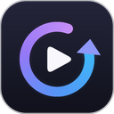

# Keep_Watching



Estensione per **Chrome** e **Brave** che su StreamingCommunity passa da sola all'episodio successivo quando quello corrente finisce, e lo fa partire con l'audio.

Il player del sito ha un pulsante "prossimo episodio", ma a fine puntata non succede nulla finché non lo si clicca, e il nuovo episodio si carica in pausa. Keep_Watching sistema entrambe le cose.

## Funzionalità

- **Prossimo episodio automatico**: a fine episodio clicca il pulsante "prossimo episodio" del player. Sull'ultimo episodio disponibile non fa nulla.
- **Avvio del nuovo episodio**: il nuovo episodio parte da solo e con l'audio, anche quando il cambio lo fai tu a mano.
- **Salta i titoli di coda**: cambia episodio da 15 secondi a 2 minuti prima della fine, oppure con un anticipo personalizzato in minuti e secondi.
- **Fermati dopo N episodi**: si ferma dopo un certo numero di cambi automatici di fila, utile se ti addormenti.
- **Dominio che cambia**: continua a funzionare quando il sito cambia dominio (`.fun`, `.xyz` e così via).

## Installazione

Il modo più rapido è usare lo zip pronto nella radice del repository, **`Keep_Watching-1.1.0.zip`**. Contiene la cartella `Keep_Watching` con i soli file dell'estensione.

1. Scarica `Keep_Watching-1.1.0.zip` ed estrailo con "Estrai qui": ottieni la cartella `Keep_Watching`. Tienila: il browser carica l'estensione da lì ogni volta.
2. Apri `chrome://extensions` (su Brave `brave://extensions`).
3. Attiva **Modalità sviluppatore** in alto a destra.
4. Clicca **Carica estensione non pacchettizzata** e seleziona la cartella `Keep_Watching`, quella che contiene `manifest.json`.

Al primo avvio il browser crea dentro la cartella una sottocartella `_metadata`: è normale, contiene una versione precompilata delle regole di rete.

In alternativa si può clonare il repository e selezionare direttamente la sua cartella: funziona allo stesso modo.

In fase di installazione il browser avvisa che l'estensione può leggere i dati su tutti i siti. Succede perché il sito cambia dominio e l'estensione si aggancia al percorso delle pagine (`/iframe/`, `/watch/`), non a un dominio fisso. In pratica agisce solo sull'iframe del player di vixcloud.co. I dettagli sono nella sezione [Permessi](#permessi).

### Aggiornare

Estrai lo zip della nuova versione al posto della cartella vecchia (o fai `git pull`), poi in `chrome://extensions` premi l'icona di ricarica sulla scheda di Keep_Watching e ricarica la pagina del sito. Se la nuova versione chiede permessi nuovi, rimuovi l'estensione e caricala di nuovo.

## Uso

Apri un episodio e premi play almeno una volta: senza un tuo primo click il browser non lascia partire l'audio da solo. Da lì in poi fa tutto l'estensione.

Le opzioni si cambiano cliccando l'icona di Keep_Watching nella barra del browser e vengono salvate subito.

| Opzione | Effetto | Predefinito |
|---|---|---|
| Prossimo episodio automatico | Passa al successivo a fine episodio | Attivo |
| Avvia il nuovo episodio | Fa partire il nuovo episodio se si carica in pausa | Attivo |
| Salta i titoli di coda | Cambia episodio prima della fine: valori pronti fino a 2 minuti, oppure **Personalizzato…** con minuti e secondi | No |
| Fermati dopo | Numero massimo di cambi automatici di fila | Nessun limite |

L'estensione funziona anche con la finestra ridotta a icona. Se in quel caso il browser non lascia partire il nuovo episodio, l'avvio viene ripetuto appena torni sulla scheda.

Il conteggio di "Fermati dopo" riparte da zero dopo 3 ore senza cambi automatici, oppure con il pulsante **Azzera** nel menu.

## Come funziona

La pagina del sito è formata da tre livelli annidati:

```
<dominio>/it/watch/<id>                   pagina principale (non si ricarica tra un episodio e l'altro)
 └─ <dominio>/it/iframe/<id>?episode_id=… iframe intermedio (si ricarica a ogni episodio)
     └─ vixcloud.co/embed/<id>?token=…     player JW Player (nuovo a ogni episodio)
```

- `src/player.js` gira nel player. Rileva la fine dell'episodio, clicca "prossimo episodio" e, nel nuovo episodio, lo avvia se è rimasto in pausa.
- `src/autoplay-permission.js` e `rules.json` fanno caricare il player con il permesso `allow="autoplay"`, che il sito non concede e senza il quale il browser blocca l'audio.

La spiegazione completa, i punti fragili e la guida alla risoluzione dei problemi sono in **[docs/MANUTENZIONE.md](docs/MANUTENZIONE.md)**.

## Permessi

| Permesso | Perché serve |
|---|---|
| `storage` | Salvare le opzioni e passare informazioni da un episodio al successivo |
| `declarativeNetRequest` | Bloccare il primo caricamento del player, che parte senza permesso di autoplay, così che l'estensione lo rifaccia con il permesso |
| Script su `*/iframe/*` e `*/watch/*` | Aggiungere il permesso di autoplay all'iframe del player, su qualunque dominio usi il sito |
| Script su `vixcloud.co/embed/*` | Controllare il player |

L'estensione non raccoglie né invia dati: non fa richieste di rete proprie e usa solo lo spazio di archiviazione locale del browser.

## Struttura del repository

```
Keep_Watching-1.1.0.zip     pacchetto pronto da installare (cartella Keep_Watching con i soli file dell'estensione)
manifest.json               configurazione dell'estensione (Manifest V3)
rules.json                  regola di rete per il permesso di autoplay
src/
  defaults.js               opzioni predefinite e chiavi di archiviazione
  player.js                 logica nel player: cambio episodio e avvio
  autoplay-permission.js    permesso di autoplay sull'iframe del player
  popup/                    menu dell'icona (HTML, CSS, JS)
icons/                      icone 16, 32, 48, 128 px
tools/
  make_icons.py             rigenera le icone
  package.sh / package.ps1  crea lo zip di installazione nella radice
docs/
  MANUTENZIONE.md           guida tecnica e risoluzione dei problemi
```

## Note

Progetto personale, non affiliato a StreamingCommunity né a JW Player. L'estensione automatizza soltanto i controlli del player, senza modificare i contenuti del sito.

## Licenza

[MIT](LICENSE)
